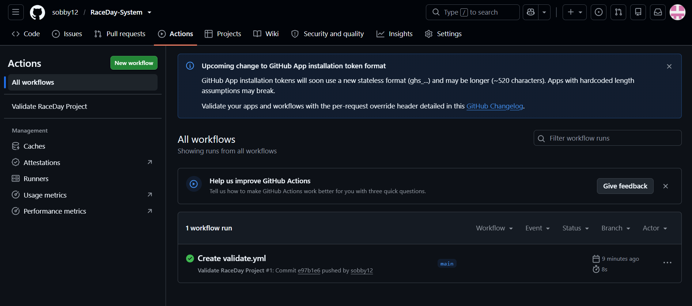

# RaceDay System — RESTful API Development

## 1. Project Overview

RaceDay System is a race and event management system designed to support running, walking and cycling events. The project includes database design and a RESTful API developed using ASP.NET Core.

The API supports user registration and login, event management, race categories, participant enrolments and race results. Authentication and role-based authorization help protect operations that require permission.

## 2. Technologies Used

- C# and ASP.NET Core Web API
- .NET 10
- Microsoft SQL Server
- Entity Framework Core
- JWT (JSON Web Token) authentication
- Swagger / OpenAPI
- xUnit for automated unit testing
- Git and GitHub for source control
- GitHub Actions for continuous integration
- Visual Studio for development

## 3. Database

The database is named `RaceDayDB` and uses Microsoft SQL Server. The application connects through the connection string configured in `appsettings.json`.

The main database entities are:

- Roles
- Users
- Events
- Categories
- EventEnrollments
- Results

Primary keys, foreign keys, unique constraints and check constraints help maintain data integrity.

### Database Setup

1. Install SQL Server and SQL Server Management Studio (SSMS).
2. Execute the database script provided in the `docs` folder, if setting up a fresh database.
3. Configure the SQL Server connection string for the local environment.
4. Open the solution in Visual Studio.
5. Restore the NuGet packages and build the solution.
6. Run the API and open Swagger to test the endpoints.

Do not execute a database-creation script over an existing database without first checking its contents.

## 4. Authentication and Authorization

The API provides registration and login endpoints.

- `POST /api/Auth/register` — Register a participant account.
- `POST /api/Auth/login` — Authenticate a user and receive a JWT.

Passwords are hashed using ASP.NET Core's `PasswordHasher`. After successful login, the API generates a token containing the user's identity and role.

Protected endpoints use JWT bearer authentication. Role-based authorization restricts operations according to the permissions implemented in the controllers.

Participants can access their own enrolments and results. Administrative roles are required for protected management operations, including viewing all enrolments and recording or managing results.

For local development, configure the JWT signing key securely. Do not use development keys or local credentials in a production deployment.

## 5. API Endpoints

The following are examples of implemented API operations. Open Swagger to view the available routes and request requirements.

| Method | Endpoint | Purpose |
|---|---|---|
| POST | `/api/Auth/register` | Register a user |
| POST | `/api/Auth/login` | Log in and obtain a token |
| GET | `/api/Events` | View events |
| POST | `/api/Events` | Create an event |
| PUT | `/api/Events/{id}` | Update an event |
| DELETE | `/api/Events/{id}` | Delete an event |
| GET | `/api/Categories` | View categories |
| POST | `/api/Categories` | Create a category |
| GET | `/api/Enrolments/Me` | View the logged-in participant's enrolments |
| POST | `/api/Events/{eventId}/Enrolments` | Enrol in an event |
| DELETE | `/api/Enrolments/{id}` | Cancel an enrolment |
| GET | `/api/Results/Me` | View the logged-in participant's results |
| POST | `/api/Enrolments/{enrolmentId}/Result` | Record a result |

The exact route names, supported HTTP methods and authorization requirements should be verified in the controllers and Swagger documentation.

## 6. Running the Application

1. Open `RaceDay.slnx` in Visual Studio.
2. Confirm that the connection string and JWT settings are configured for your development environment.
3. Restore the NuGet packages.
4. Build the solution.
5. Run `RaceDay.API`.
6. Open the Swagger interface at the HTTPS address displayed in the Visual Studio output, followed by `/swagger`.

For example, the local development address may be `https://localhost:7258/swagger`. The port can differ between environments.

To test protected endpoints, register or log in, copy the returned JWT, select **Authorize** in Swagger and enter the token using the expected bearer-token format.

## 7. Testing

The `RaceDay.API.Tests` project contains automated xUnit tests.

The current tests check basic category-name validation:

- A non-empty category name is considered valid.
- An empty category name is considered invalid.

The tests were run in Visual Studio, and both passed. The complete solution also built successfully.

These tests provide an initial automated test suite. Additional tests for authentication, authorization, API responses and database operations would improve test coverage.

## 8. GitHub Actions and CI/CD

The project is stored in the RaceDay-System GitHub repository.

GitHub Actions is used for automated validation. The RaceDay API CI workflow is configured to restore dependencies and build the solution when changes are pushed to the main branch or when a pull request targets that branch.

A successful workflow run provides evidence that the configured build process completed successfully. The result can be viewed under the repository's **Actions** tab.

### Successful GitHub Actions Workflow

The screenshot below provides evidence of the GitHub Actions workflow completing successfully.

## 9. Project Structure

- `RaceDay.API/` — ASP.NET Core API, controllers, models, data access and configuration.
- `RaceDay.API.Tests/` — Automated unit tests.
- `docs/` — Part 1 documentation, including the ERD, endpoint plan and SQL script.
- `.github/workflows/` — GitHub Actions workflow files.
- `RaceDay.slnx` — Visual Studio solution file.
- `README.md` — Project overview and setup instructions.

## 10. Part 1 Documentation

The repository contains the planning and database documentation developed in Part 1:

- **ERD:** `docs/RaceDay_ERD.drawio.png`
- **Endpoint plan:** `docs/RaceDay.docx`
- **SQL database script:** `docs/RaceDay_Database_Final.sql`

These documents describe the database structure, planned API operations and SQL implementation.

## 11. Future Improvements

Possible improvements include increasing automated test coverage, adding integration tests, improving error handling, introducing production-ready secret management, and expanding API documentation.

## 12. Project Demonstration

The project demonstration should show the running API, Swagger endpoints, authentication, role-based access, enrolment and result operations, automated test results, and the successful GitHub Actions run.

The existing Part 1 walkthrough is available here:

[Watch the RaceDay System Part 1 walkthrough](https://youtu.be/IO0UysTTx9Q)

A separate Part 2 demonstration should be added if required by the assessment rubric.

